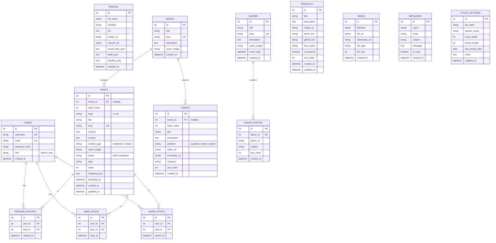
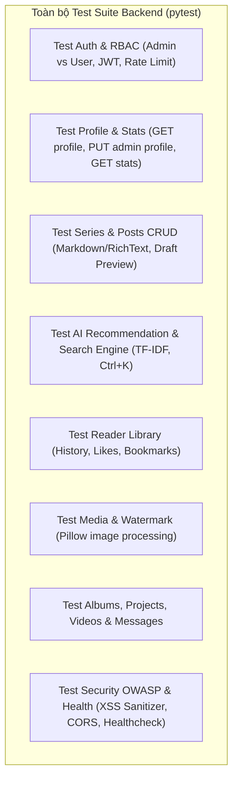

# TÀI LIỆU ĐẶC TẢ YÊU CẦU PHẦN MỀM (SRS) - PHIÊN BẢN MỞ RỘNG TOÀN DIỆN
## DỰ ÁN: PERSONAL PORTFOLIO, BLOG, VIDEO & ALBUM PLATFORM (AllinOneBlog)

---

## 1. GIỚI THIỆU (INTRODUCTION)

### 1.1 Mục đích (Purpose)
Tài liệu Đặc tả Yêu cầu Phần mềm (Software Requirements Specification - SRS) này mô tả chi tiết các yêu cầu chức năng, phi chức năng, kiến trúc kỹ thuật, chuẩn bảo mật OWASP Top 10, cấu hình CORS, thiết kế cơ sở dữ liệu và danh sách API hoàn chỉnh cho hệ thống website cá nhân tích hợp:
- **Portfolio cá nhân năng động** (Dynamic Profile: Bio, Skills, Interactive Timeline, CV download).
- **Hệ thống Blog kỹ thuật chuyên sâu** (hỗ trợ Series, Micro-reactions, Dual-mode Editor, Draft Preview, AI Recommendations, Sticky Scrollspy TOC).
- **Trải nghiệm đọc Blog nâng cao** (Reader Mode đóng/mở sidebar, Relative Time "X ngày trước", nhãn tác giả `@username`).
- **Hỗ trợ Đa ngôn ngữ (Multi-language i18n)**: Chuyển đổi linh hoạt Tiếng Việt / Tiếng Anh (`?lang=vi` / `?lang=en`) đồng bộ URL và Navbar.
- **Phân khu Album Ảnh (Photo / Life Gallery `/album`)**: Trưng bày các bộ sưu tập nhiếp ảnh, ảnh sự kiện, đời sống cá nhân riêng biệt.
- **Tự động đóng dấu bản quyền ảnh (Image Watermarking)**: Xử lý đóng dấu bản quyền logo/tên miền tự động bằng Python Pillow trước khi lưu trữ.
- **Thư viện Video Showcase**: Nhúng và phát video YouTube/Vimeo/Cloudinary.
- **Trình tìm kiếm toàn cục Spotlight (`Ctrl + K`)**: Tra cứu tức thì gộp Projects, Posts, Videos, Albums.
- **Quản lý Media độc lập & SEO Tự động (Sitemap & RSS Feed)**.
- **Hệ thống Quản trị Người dùng & Bảo mật Chuyên sâu**: Phân quyền, khóa tài khoản, Admin reset password với thu hồi phiên tức thì (`token_version`), giám sát Realtime Online Presence qua Socket.IO.
- **Bảo vệ L7 Anti-DDoS & Rate Limiting Thông Minh**: Kết hợp `ProxyFix`, rate limiting định danh `user_id` / `ip_address`, chuẩn hóa `Retry-After: 60` và ghi Audit Log.
- **Phân trang Phổ quát (Universal Pagination & Rows Per Page)**: Hỗ trợ tùy chỉnh số dòng hiển thị (5, 10, 20, 50 dòng/trang) đồng bộ trên toàn bộ 9 tab quản trị.
- **Tab Ẩn Bí Mật (Secret 28-Day Cycle Tracker)**: Truy cập bằng phím tắt `Ctrl + Shift + H`, bảo vệ 2 lớp bằng mã PIN độc lập, đồng hồ tròn chu kỳ 28 ngày và hệ thống gợi ý chăm sóc tâm lý.

### 1.2 Phạm vi dự án (Scope)
Hệ thống là nền tảng cá nhân hóa tối cao phục vụ hai nhóm đối tượng:
1. **Khách truy cập (Public Visitors / Nhà tuyển dụng / Độc giả quốc tế & trong nước)**: Xem hồ sơ năng lực động, chuyển đổi ngôn ngữ Việt - Anh, duyệt bài viết theo chuỗi (Series), trải nghiệm đọc chuyên nghiệp (Reader Mode, TOC, Reactions, Bookmarks), thưởng thức Album ảnh và Video, tìm kiếm Spotlight nhanh qua `Ctrl + K`.
2. **Quản trị viên duy nhất (Site Admin / Owner)**: Đăng nhập quản trị bảo mật JWT, giám sát Dashboard Analytics, quản lý thông tin hồ sơ cá nhân không cần sửa code, quản lý chuỗi bài viết (Series), soạn thảo linh hoạt (Markdown/Rich Text), quản lý Media và Album ảnh độc lập có tự động đóng dấu bản quyền (Watermark), xem trước bản nháp qua token bảo mật tạm thời (Draft Preview).

---

## 2. KIẾN TRÚC TỔNG THỂ & TECH STACK

### 2.1 Cấu trúc Monorepo
```text
AllinOneBlog/
├── backend/                  # Python Flask RESTful API
│   ├── app/
│   │   ├── models/           # User, Profile, Series, Post, Video, Project, Album, Media, Message
│   │   ├── routes/           # auth, profile, series, posts, videos, projects, albums, media, search, health, feed
│   │   ├── services/         # AI Recommendation (TF-IDF/Cosine), Search Engine, Watermark Service (Pillow)
│   │   ├── utils/            # JWT decorators, slug generator, security sanitizers, rate limiter
│   │   └── __init__.py       # App factory, blueprints registration, CORS, error handlers
│   ├── instance/
│   │   └── database.sqlite   # SQLite database file
│   ├── uploads/              # Thư mục lưu trữ media cục bộ
│   ├── requirements.txt      # Python dependencies đã khóa phiên bản (Flask, SQLAlchemy, Pillow, etc.)
│   ├── run.py                # Entry point khởi chạy backend
│   └── .env.example          # Mẫu cấu hình môi trường bảo mật
├── frontend/                 # React 19 + Vite 8 + Tailwind CSS v4
│   ├── src/
│   │   ├── assets/           # Static assets, styles
│   │   ├── components/       # SpotlightModal, Navbar, Footer, TOC, CodeBlock, ReactionBar, LanguageSwitcher, ReaderModeToggle
│   │   ├── contexts/         # AuthContext, ThemeContext, LanguageContext, BookmarkContext
│   │   ├── locales/          # vi.json, en.json (Dữ liệu đa ngôn ngữ giao diện)
│   │   ├── pages/            # Public (Home, Blog, BlogDetail, Series, Videos, Albums) & Admin (Dashboard, Editors, CMS)
│   │   ├── services/         # Axios API clients
│   │   ├── App.jsx           # Routing & App Layout
│   │   └── main.jsx
│   ├── package.json
│   ├── vite.config.js
│   └── .env.example
├── SRS.md                    # Bản đặc tả yêu cầu kỹ thuật chuẩn hóa
└── README.md
```

### 2.2 Công nghệ sử dụng
- **Frontend**: React 19, Vite 8, Tailwind CSS v4 (`@tailwindcss/vite`), Lucide React, Axios, React Router DOM v7.
- **Backend**: Python 3.11, Flask 3.0, Flask-SQLAlchemy 3.1, Flask-JWT-Extended 4.6, Flask-Limiter 3.8, Flask-CORS 4.0, Bleach 6.1, Pillow 13.0 (Xử lý đóng dấu Watermark ảnh), Scikit-learn 1.5 & Numpy 2.4 (AI Recommendation & Search Engine), Werkzeug 3.0.
- **Database**: SQLite 3.

---

## 3. CƠ SỞ DỮ LIỆU TOÀN DIỆN (DATABASE SCHEMA)



---

## 4. ĐẶC TẢ YÊU CẦU CHỨC NĂNG CHI TIẾT (FUNCTIONAL REQUIREMENTS)

### 4.1 Phân hệ Người dùng Công khai (Public Facing)

#### 4.1.1 Đa ngôn ngữ (Multi-language i18n VI / EN) - [Must]
- **FR-PUB-01 (Language Switcher)**: Nút chuyển đổi nhanh ngôn ngữ (VN / EN) trên Navbar.
- **FR-PUB-02 (Synchronized Locale State)**:
  - Đồng bộ trạng thái ngôn ngữ trên tham số URL (`?lang=vi` hoặc `?lang=en`) và lưu vào `localStorage`.
  - Toàn bộ giao diện tĩnh (Menus, Buttons, Footer, Labels) tự động dịch theo từ điển ngôn ngữ.
  - Bộ lọc bài viết và API tự động ưu tiên lấy bài viết theo mã ngôn ngữ tương ứng (`lang = 'vi'` hoặc `lang = 'en'`).

#### 4.1.2 Trang chủ Portfolio Năng động (`/`) - [Must]
- **FR-PUB-03 (Dynamic Profile & Hero with Live Status)**: 
  - Render thông tin lấy từ API `GET /api/profile` (Avatar, Tên, Chức danh, Bio, Nút tải CV PDF, Nút liên hệ). Không hardcode thông tin cá nhân.
  - **Live Status Badge**: Huy hiệu trạng thái làm việc trực tiếp (ví dụ: `🟢 Sẵn sàng nhận dự án mới / Available for work` hoặc `🟡 Đang bận dự án`) hiển thị nổi bật trên Hero section.
- **FR-PUB-04 (Interactive Timeline & Skills)**: Hiển thị kinh nghiệm làm việc theo trục thời gian (Timeline) và nhóm kỹ năng kỹ thuật (Frontend, Backend, DevOps, AI) với hiệu ứng badge trực quan.
- **FR-PUB-05 (Featured Projects Showcase)**: Lưới dự án nổi bật (`is_featured = true`) kèm tag công nghệ, demo link, github repo.
- **FR-PUB-06 (Quick Contact Form)**: Gửi tin nhắn liên hệ (Tên, Email, Tiêu đề, Nội dung) có kiểm tra rate limit chống spam.

#### 4.1.3 Phân hệ Chuỗi bài viết (Series / Playlists) (`/series`, `/series/:slug`) - [Must]
- **FR-PUB-07 (Series Listing & Detail)**:
  - Trang danh sách các chuỗi bài viết/video dài kỳ kèm số lượng bài và ảnh bìa.
  - Trang chi tiết series liệt kê danh sách các bài viết / video theo thứ tự lộ trình học (`order_index ASC`) với thanh tiến trình theo dõi.

#### 4.1.4 Phân hệ Blog Chuyên sâu (`/blog`, `/blog/:slug`) - [Must]
- **FR-PUB-08 (Blog Card Grid & Hiển thị Tinh tế)**:
  - Hiển thị danh sách bài viết dạng lưới Card Grid gồm: Ảnh bìa (thumbnail), tiêu đề, đoạn trích ngắn (excerpt), **thời gian đăng tương đối (Relative Time: "5 ngày trước", "2 giờ trước")**, thông tin tác giả kèm username (`@tumivn`), nhãn ngôn ngữ (Tiếng Việt / English), danh sách thẻ (tags), số lượt xem và thống kê lượt thả tim.
  - Lọc theo Thẻ (Tags) lấy từ API `GET /api/tags`.
  - **Link Hover Preview Tooltip**: Khi người đọc rê chuột (hover) vào liên kết bài viết nội bộ, hiển thị thẻ popover xem trước tóm tắt bài viết (ảnh bìa, tiêu đề, excerpt, thời gian đọc) giúp tăng trải nghiệm duyệt bài.
  - Lưu và quản lý danh sách "Đọc sau" (Bookmarks) tại LocalStorage của trình duyệt.
- **FR-PUB-09 (Deep Reading, Reader Mode & Accessibility)**:
  - **Text-to-Speech (Nghe bài viết Audio)**: Tích hợp trình phát audio đọc bài viết tự động (sử dụng Web Speech API / TTS), có nút Play/Pause/Tua lại và thanh tiến trình nghe dành cho độc giả thích nghe podcast/audiobook.
  - **Tùy chỉnh Font & Cỡ chữ (Reading Preferences)**: Thanh công cụ cho phép người đọc tùy chỉnh cỡ chữ (A- / A+), chuyển đổi giữa font Serif (báo chí cổ điển) và Sans-serif (hiện đại, dễ đọc) và lưu cấu hình vào `localStorage`.
  - **Bố cục đọc tập trung (Reader Mode / Toggle Sidebar)**: Nút biểu tượng ở góc phải bài viết cho phép đóng/mở thanh bên (Sidebar) để người đọc tùy biến không gian đọc rộng rãi, tập trung tối đa vào nội dung bài viết.
  - **Mục lục tự động (Sticky Table of Contents - "Trong trang này")**: Trích xuất tự động H2/H3 tạo danh sách mục lục cố định bên phải màn hình, có hiệu ứng Scrollspy đánh dấu mục đang đọc khi cuộn trang và gắn anchor link trên URL.
  - **Thanh tiến trình đọc & Back to Top**: Hiển thị thanh tiến trình % cuộn trang mượt mà bám sát đỉnh màn hình kèm nút **Cuộn nhanh lên đầu trang (Back to Top)** với vòng tròn tiến trình cuộn tròn (% Circular Progress).
  - **Dual-mode Render**: Render Markdown (GFM, bảng, code syntax highlight kèm nút Copy 1 chạm và nhãn ngôn ngữ) hoặc HTML Rich Text được làm sạch (Sanitized).
  - **Prev/Next Navigation & Related Posts**: Điều hướng bài trước và bài tiếp theo; hiển thị 3-4 bài liên quan do AI Recommendation System (TF-IDF + Cosine Similarity) gợi ý.
  - **Micro-reactions**: Thả tim và cảm xúc đa dạng (🔥, ❤️, 💡, 🚀) không cần đăng nhập, chống spam bằng LocalStorage và Rate limit IP.

#### 4.1.5 Trải nghiệm Chuyển trang & Hiệu ứng Thị giác (UI Smoothness) - [Should]
- **FR-PUB-10 (Smooth Transitions & Skeleton Shimmer)**:
  - Áp dụng hiệu ứng tải khung xương (Skeleton Shimmer Loading) cho toàn bộ Card Grid, danh sách bài viết, profile và video, loại bỏ hiện tượng giật cục Layout Shift (CLS).
  - Hiệu ứng chuyển trang mượt mà (Fade / Slide page transitions).

#### 4.1.6 Không gian Cá nhân Độc giả (My Library `/my-library`) - [Must]
- **FR-PUB-11 (Reader Authentication & Library Sync)**:
  - Cho phép độc giả đăng ký/đăng nhập tài khoản cá nhân (`role = 'user'`).
  - Trang Thư viện cá nhân (`/my-library`) gồm 3 tabs trực quan giúp quản lý và đồng bộ dữ liệu giữa các thiết bị:
    1. **Lịch sử xem bài viết (Reading History)**: Danh sách các bài viết đã xem gần nhất, hiển thị thời gian đọc tương đối, kèm nút "Xóa lịch sử xem" (Clear History) hoặc xóa từng mục.
    2. **Bài viết đã thích (Liked Posts)**: Tổng hợp các bài viết độc giả đã bấm thả tim/reaction.
    3. **Bài viết đã lưu (Saved Bookmarks)**: Danh sách bài viết được đánh dấu lưu lại để đọc sau (Bookmarked).
  - Tự động ghi nhận lịch sử vào bảng `ReadingHistory` khi độc giả đã đăng nhập mở đọc một bài viết blog.
  - Cho phép gỡ bài khỏi danh sách thích hoặc danh sách đã lưu chỉ với 1 cú click.

#### 4.1.7 Phân khu Album Ảnh (Photo Gallery `/album`, `/album/:slug`) - [Must]
- **FR-PUB-12 (Album Showcase)**:
  - Khu vực trưng bày các bộ sưu tập nhiếp ảnh, ảnh sự kiện, du lịch hoặc khoảnh khắc đời sống.
  - Xem chi tiết từng album dưới dạng lưới ảnh nghệ thuật (Masonry / Lightbox gallery), hỗ trợ phóng to ảnh full màn hình và xem chú thích ảnh (Captions).

#### 4.1.8 Tìm kiếm toàn cục dạng Spotlight (`Ctrl + K`) - [Must]
- **FR-PUB-13 (Spotlight Command Palette)**:
  - Mở tức thì bằng phím tắt `Ctrl + K` (hoặc `Cmd + K`) hoặc icon Search trên Navbar.
  - Trả về kết quả gộp tức thì và phân nhóm rõ ràng: `{ projects: [...], posts: [...], videos: [...], albums: [...] }`.

#### 4.1.9 Phân hệ Thư viện Video (`/videos`) - [Must]
- **FR-PUB-14 (Responsive Video Gallery)**:
  - Danh sách video nhúng (YouTube, Vimeo, Cloudinary...) có phân loại chuyên mục và phát trực tiếp qua modal responsive.

#### 4.1.10 Giao diện Sáng / Tối & SEO Tự động - [Should]
- **FR-PUB-15 (Theme Toggle)**: Nút mặt trăng/mặt trời trên header chuyển đổi Dark/Light mode mượt mà.
- **FR-PUB-16 (Automated SEO & RSS)**: `/sitemap.xml` và `/rss.xml` tự động sinh chuẩn XML cho Google Bot và các trình đọc tin RSS.

---

### 4.2 Phân hệ Quản trị (Admin CMS & Control Panel)

#### 4.2.1 Xác thực & Dashboard Analytics (`/login`, `/admin`) - [Must]
- **FR-ADM-01 (Authentication & Rate Limiting)**: Đăng nhập Admin duy nhất, cấp phát JWT, giới hạn 5 lần thử/phút chống Brute-force.
- **FR-ADM-02 (Dashboard Analytics)**: Thống kê tổng lượt xem, tổng bài viết, video, dự án, album; top bài viết nhiều tương tác nhất; cảnh báo tin nhắn liên hệ chưa đọc.

#### 4.2.2 Quản lý Hồ sơ Động (`/admin/profile`) - [Must]
- **FR-ADM-03 (Profile CMS)**: Cập nhật Bio, chức danh, upload CV PDF, cập nhật link mạng xã hội, thêm/sửa/xóa các mốc Timeline và kỹ năng.

#### 4.2.3 Quản lý Bài viết, Đa ngôn ngữ & Draft Preview (`/admin/posts/*`) - [Must]
- **FR-ADM-04 (Dual-mode CMS Editor)**: Soạn thảo Markdown (Live Split Preview) hoặc Rich Text (WYSIWYG), chọn ngôn ngữ bài viết (`lang = 'vi' | 'en'`), gán Series và thứ tự `order_index`.
- **FR-ADM-05 (Ephemeral Draft Preview)**: Tạo mã preview token tạm thời (15 phút) xem trước bài nháp trên giao diện thật mà không cần public.

#### 4.2.4 Quản lý Media & Đóng dấu Bản quyền Tự động (Watermark) (`/admin/media`) - [Must]
- **FR-ADM-06 (Auto Watermark Image Processing)**:
  - Khi tải ảnh lên, Backend Python sử dụng thư viện **Pillow** để tự động đóng dấu bản quyền tên miền/logo (ví dụ: `© yourdomain.blog` hoặc watermark tùy chỉnh) ở góc dưới ảnh một cách tinh tế trước khi lưu.
  - Quản lý thư viện media (upload, xem trước, xóa ảnh).

#### 4.2.5 Quản lý Chuỗi bài viết & Album (`/admin/series`, `/admin/albums`) - [Must]
- **FR-ADM-07 (Series & Album CRUD)**: Tạo, cập nhật, xóa series và các bộ sưu tập album ảnh (upload nhiều ảnh cùng lúc vào album).

#### 4.2.6 Quản lý Dự án, Video & Tin nhắn (`/admin/projects`, `/admin/videos`, `/admin/messages`) - [Must]
- **FR-ADM-08 (Resource Management)**: CRUD Projects, Videos và quản lý duyệt/xóa tin nhắn liên hệ.

---

## 5. DANH SÁCH RESTful API TOÀN DIỆN (API SPECIFICATION)

### 5.1 System & Health Check
- `GET /api/health`: Kiểm tra server và kết nối database SQLite.
- `GET /sitemap.xml`: Trả về Dynamic XML Sitemap cho SEO.
- `GET /rss.xml`: Trả về RSS 2.0 Feed bài viết.

### 5.2 Authentication & User Accounts
- `POST /api/auth/register`: Độc giả đăng ký tài khoản mới (`role = 'user'`).
- `POST /api/auth/login`: Xác thực đăng nhập (Admin & User) (Rate limit: 5 req/min), trả về JWT chứa thông tin `role` và `username`.
- `GET /api/auth/me`: Kiểm tra phiên đăng nhập hiện tại và quyền hạn (Protected).

### 5.3 Reader Library (Lịch sử, Đã thích & Đã lưu) - Protected (User/Admin)
- `GET /api/user/history`: Lấy danh sách lịch sử đọc của người dùng hiện tại (hỗ trợ phân trang).
- `POST /api/user/history/:post_id`: Ghi nhận bài viết vào lịch sử đọc.
- `DELETE /api/user/history`: Xóa toàn bộ lịch sử đọc của người dùng.
- `DELETE /api/user/history/:post_id`: Xóa một bài viết khỏi lịch sử đọc.
- `GET /api/user/likes`: Lấy danh sách các bài viết người dùng đã bấm thích/reaction.
- `GET /api/user/bookmarks`: Lấy danh sách bài viết đã lưu để đọc sau.
- `POST /api/user/bookmarks/:post_id`: Thêm bài viết vào danh sách đã lưu (Bookmark).
- `DELETE /api/user/bookmarks/:post_id`: Gỡ bài viết khỏi danh sách đã lưu.

### 5.4 Dynamic Profile & Dashboard Stats
- `GET /api/profile`: Lấy thông tin cá nhân, kỹ năng, timeline, social links (Public - hỗ trợ query `?lang=vi/en`).
- `PUT /api/admin/profile`: Cập nhật thông tin hồ sơ (Admin Only).
- `GET /api/admin/stats`: Lấy thống kê tổng hợp Dashboard (Admin Only).

### 5.4 Series (Chuỗi bài viết / Playlists)
- `GET /api/series`: Lấy danh sách series (Public).
- `GET /api/series/:slug`: Lấy chi tiết series kèm danh sách posts/videos theo thứ tự (Public).
- `POST /api/admin/series`: Tạo series mới (Admin Only).
- `PUT /api/admin/series/:id`: Cập nhật series (Admin Only).
- `DELETE /api/admin/series/:id`: Xóa series (Admin Only).

### 5.5 Posts (Blog) & Tương tác
- `GET /api/posts`: Danh sách bài viết đã xuất bản (hỗ trợ phân trang, lọc `tag`, `series_id`, và lọc `lang=vi|en`).
- `GET /api/posts/:slug`: Chi tiết bài viết (tự động tăng views, trả kèm thông tin tác giả `@username`, `navigation.prev`, `navigation.next` và `related_posts`).
- `GET /api/posts/:slug/preview?token=...`: Xem trước bài nháp qua token bảo mật tạm thời (Public có token).
- `POST /api/admin/posts/:id/preview-token`: Sinh token xem trước bài nháp (Admin Only).
- `POST /api/posts/:slug/reactions`: Thả cảm xúc (🔥, ❤️, 💡, 🚀) (Rate limit: 30 req/min/IP).
- `GET /api/tags`: Danh sách thẻ tags kèm số lượng bài viết tương ứng.
- `GET /api/admin/posts`: Lấy toàn bộ bài viết kể cả bản nháp (Admin Only).
- `POST /api/posts`: Tạo bài viết mới (Admin Only).
- `PUT /api/posts/:id`: Cập nhật bài viết (Admin Only).
- `DELETE /api/posts/:id`: Xóa bài viết (Admin Only).

### 5.6 Album Ảnh (Photo Gallery)
- `GET /api/albums`: Lấy danh sách các bộ sưu tập album ảnh (Public).
- `GET /api/albums/:slug`: Lấy chi tiết album kèm danh sách toàn bộ ảnh và caption (Public).
- `POST /api/admin/albums`: Tạo album mới (Admin Only).
- `PUT /api/admin/albums/:id`: Cập nhật album (Admin Only).
- `DELETE /api/admin/albums/:id`: Xóa album (Admin Only).
- `POST /api/admin/albums/:id/photos`: Upload và gắn ảnh vào album (tự động watermark) (Admin Only).
- `DELETE /api/admin/photos/:id`: Xóa ảnh khỏi album (Admin Only).

### 5.7 Global Search Engine
- `GET /api/search?q=keyword`: Tìm kiếm tức thì dạng Spotlight gộp Projects, Posts, Videos và Albums (Public).

### 5.8 Media Management & Watermark
- `POST /api/admin/media/upload`: Upload file ảnh/tài liệu (tự động chạy qua service Pillow để đóng dấu Watermark) (Admin Only).
- `GET /api/admin/media`: Xem danh sách file media đã upload (Admin Only).
- `DELETE /api/admin/media/:id`: Xóa file media khỏi hệ thống (Admin Only).

### 5.9 Projects & Videos
- `GET /api/projects`: Danh sách dự án (Public - lọc `featured=true`).
- `POST /api/projects`: Tạo dự án (Admin Only).
- `PUT /api/projects/:id`: Cập nhật dự án (Admin Only).
- `DELETE /api/projects/:id`: Xóa dự án (Admin Only).
- `GET /api/videos`: Danh sách video (Public).
- `POST /api/videos`: Thêm video (Admin Only).
- `PUT /api/videos/:id`: Sửa video (Admin Only).
- `DELETE /api/videos/:id`: Xóa video (Admin Only).

### 5.10 Contact Messages
- `POST /api/contact`: Gửi tin nhắn liên hệ (Public có rate limit).
- `GET /api/admin/messages`: Xem danh sách tin nhắn (Admin Only).
- `PUT /api/admin/messages/:id/read`: Đánh dấu tin nhắn đã đọc (Admin Only).
- `DELETE /api/admin/messages/:id`: Xóa tin nhắn (Admin Only).

---

## 6. TIÊU CHUẨN BẢO MẬT OWASP TOP 10 & CLEAN CODE

1. **CORS Control**: Quản lý chặt chẽ qua `.env` (`CORS_ORIGINS`).
2. **Broken Access Control & IDOR**: Toàn bộ API ghi/xóa/sửa được bảo vệ nghiêm ngặt bằng JWT `@jwt_required()`.
3. **Injection (SQLi & XSS)**: SQLAlchemy ORM Parameterized Queries; Sanitization 2 lớp với `bleach` (Backend) và `DOMPurify` (Frontend).
4. **Brute-Force & Rate Limiting**: Cấu hình `Flask-Limiter` bảo vệ các endpoint login, reaction, contact.
5. **Clean Code & Modular**: Backend theo Application Factory + Blueprints (PEP 8, Type Hints, Docstrings, JSON Response chuẩn). Frontend tách rành mạch Presentational vs Container components, Tailwind CSS tái sử dụng, không prop-drilling.

---

## 7. TIÊU CHÍ CHẤP NHẬN BÀN GIAO (ACCEPTANCE CRITERIA)

| Hạng mục | Tiêu chí chấp nhận |
| :--- | :--- |
| **Đa ngôn ngữ (i18n)** | Chuyển đổi ngôn ngữ Việt - Anh linh hoạt (`?lang=vi/en`), đồng bộ URL và từ điển giao diện; lọc bài viết theo ngôn ngữ. |
| **Thư viện Độc giả (My Library)** | Độc giả đăng ký/đăng nhập tài khoản; xem lại và quản lý Lịch sử xem bài viết (có nút xóa), danh sách bài viết đã thích, bài viết đã lưu để đọc sau (Bookmarks) đồng bộ trên Database. |
| **Trải nghiệm đọc Blog & Tiện ích UX** | Card grid hiển thị Relative Time ("5 ngày trước"), username `@username`, tags, view/likes; Bố cục Reader Mode (nút đóng/mở sidebar); Sticky Scrollspy TOC highlight theo vị trí cuộn; Text-to-Speech (Audio player nghe bài viết); Tùy biến Cỡ chữ & Font Serif/Sans-serif; Nút Back to Top với vòng tròn % Circular Progress; Link Hover Preview Tooltip; Skeleton Shimmer Loading; Multi-reactions (🔥, ❤️, 💡, 🚀). |
| **Phân khu Album Ảnh** | Trang `/album` và `/album/:slug` hiển thị bộ sưu tập ảnh nghệ thuật, phóng to ảnh mượt mà kèm chú thích. |
| **Watermark ảnh tự động** | Ảnh tải lên được Backend (Pillow) tự động gắn watermark bản quyền tinh tế ở góc dưới. |
| **AI Recommendation & Prev/Next** | Chân bài viết hiển thị nút Bài trước / Bài kế tiếp và 3-4 bài tương quan do mô hình TF-IDF gợi ý. |
| **Spotlight Search (Ctrl+K)** | Nhấn `Ctrl+K` mở cửa sổ tìm kiếm tức thì gộp Projects, Posts, Videos, Albums với kết quả phân nhóm rõ ràng. |
| **Hồ sơ năng lực động & CMS** | Thông tin cá nhân, timeline, skills cập nhật động từ API; Quản lý Series, Media, Dự án, Video và xem trước bài nháp (Draft Preview) hoạt động hoàn hảo. |
| **Bảo mật & Clean Code** | CORS chuẩn qua `.env`; phòng chống triệt để 10 nhóm lỗ hổng OWASP; code modular, sạch đẹp, dễ bảo trì. |
| **Kiểm thử & Code Coverage** | Bộ Unit & Integration Test đạt tỷ lệ Pass 100%; Mức độ bao phủ mã nguồn (Code Coverage) đạt tối thiểu ≥ 80% trên toàn bộ Backend (Models, Routes, Services, Utils). |

---

## 8. KẾ HOẠCH & ĐẶC TẢ KIỂM THỬ TOÀN DIỆN (TEST PLAN & API TEST MATRIX) - [Must]

Mục này quy định toàn bộ kịch bản kiểm thử tự động hóa (Automated Testing với `pytest`) và kiểm thử thủ công/end-to-end cho toàn bộ các chức năng và endpoints của Backend trước khi bàn giao:

### 8.1 Bộ công cụ, Phương pháp & Tiêu chuẩn Độ phủ (Tools, Methodology & Code Coverage)
- **Framework kiểm thử Unit & Integration**: `pytest`, `pytest-flask`, client HTTP test tích hợp của Flask (`app.test_client()`).
- **Framework đo lường Độ phủ Mã nguồn (Code Coverage)**: `pytest-cov`, `coverage.py`.
- **Môi trường Test**: SQLite in-memory (`sqlite:///:memory:`) hoàn toàn cô lập, tự động thiết lập (setup) và dọn dẹp (teardown) sau mỗi ca test.
- **Tiêu chuẩn Unit Test & Code Coverage bắt buộc**:
  - **Tỷ lệ Pass**: Đạt **100%** (tất cả các unit test và integration test phải vượt qua, không có ngoại lệ).
  - **Mức độ bao phủ mã nguồn (Code Coverage Threshold)**: Đạt tối thiểu **≥ 80%** toàn bộ mã nguồn Backend (bao gồm Models, Services, Routes, Helpers/Utils).
  - **Báo cáo Coverage**: Tự động sinh báo cáo dạng terminal (`--cov-report=term-missing`) và HTML report trực quan (`--cov-report=html:tests/coverage_report`) chỉ rõ từng dòng code đã được test hoặc chưa được test.
  - **Lệnh chạy chuẩn**:
    ```bash
    pytest --cov=app --cov-report=term-missing --cov-report=html:tests/coverage_report tests/
    ```

### 8.2 Ma trận Kiểm thử API & Chức năng (API Test Matrix)



#### 8.2.1 Nhóm 1: Kiểm thử Xác thực & Phân quyền (Auth & RBAC)
| Mã Test | Endpoint / Chức năng | Dữ liệu đầu vào / Điều kiện | Kết quả kỳ vọng (Expected Output) |
| :--- | :--- | :--- | :--- |
| **TC-AUTH-01** | `POST /api/auth/register` | Username, email, password hợp lệ | Trả về `201 Created`, user có role `user`, password được hash. |
| **TC-AUTH-02** | `POST /api/auth/register` | Trùng username hoặc email đã tồn tại | Trả về `400 Bad Request` hoặc `409 Conflict`, thông báo lỗi rõ ràng. |
| **TC-AUTH-03** | `POST /api/auth/login` | Đúng username & password | Trả về `200 OK`, kèm JWT access token chứa role và thông tin người dùng. |
| **TC-AUTH-04** | `POST /api/auth/login` | Sai mật khẩu hoặc tài khoản không tồn tại | Trả về `401 Unauthorized` với thông báo chung ("Invalid credentials"). |
| **TC-AUTH-05** | `POST /api/auth/login` | Thử đăng nhập sai quá 5 lần liên tiếp trong 1 phút | Kích hoạt `Flask-Limiter`, trả về `429 Too Many Requests`. |
| **TC-AUTH-06** | `GET /api/auth/me` | Kèm header `Bearer <valid_token>` | Trả về `200 OK` với thông tin cá nhân và role chính xác. |
| **TC-AUTH-07** | Endpoint Admin bất kỳ (VD: `POST /api/projects`) | Token của tài khoản có role `user` | Trả về `403 Forbidden` (Chặn quyền hạn - RBAC). |

#### 8.2.2 Nhóm 2: Kiểm thử Hồ sơ Năng lực Động & Dashboard Stats
| Mã Test | Endpoint / Chức năng | Dữ liệu đầu vào / Điều kiện | Kết quả kỳ vọng (Expected Output) |
| :--- | :--- | :--- | :--- |
| **TC-PROF-01** | `GET /api/profile` | Không cần token (Public) | Trả về `200 OK` chứa Bio, Skills, Timeline, Social links, Live Status Badge. |
| **TC-PROF-02** | `PUT /api/admin/profile` | Token Admin, payload cập nhật kỹ năng/timeline | Trả về `200 OK`, cập nhật thành công dữ liệu mới vào SQLite. |
| **TC-STAT-01** | `GET /api/admin/stats` | Token Admin | Trả về `200 OK` chứa tổng lượt xem, tổng số bài viết, dự án, video, album và số tin nhắn chưa đọc. |

#### 8.2.3 Nhóm 3: Kiểm thử Quản lý Bài viết, Series & Xem trước bản nháp
| Mã Test | Endpoint / Chức năng | Dữ liệu đầu vào / Điều kiện | Kết quả kỳ vọng (Expected Output) |
| :--- | :--- | :--- | :--- |
| **TC-POST-01** | `POST /api/posts` | Token Admin, bài viết Markdown hoặc RichText | Trả về `201 Created`, tự động sinh slug SEO và whitelist thẻ an toàn. |
| **TC-POST-02** | `GET /api/posts` | Public, query `page=1&limit=10&lang=vi` | Trả về `200 OK`, danh sách chỉ gồm các bài có `status = 'published'`. |
| **TC-POST-03** | `GET /api/posts/:slug` | Public, slug bài viết đang ở trạng thái `draft` | Trả về `404 Not Found` (Bảo mật không lộ bài nháp ra ngoài). |
| **TC-POST-04** | `POST /api/admin/posts/:id/preview-token` | Token Admin | Sinh mã preview token có thời hạn 15 phút. |
| **TC-POST-05** | `GET /api/posts/:slug/preview?token=...` | Kèm preview token hợp lệ | Trả về `200 OK` hiển thị đầy đủ nội dung bài nháp. |
| **TC-POST-06** | `GET /api/posts/:slug` | Public, bài viết hợp lệ | Tự động tăng `views` thêm 1, trả kèm `navigation.prev`, `navigation.next`. |
| **TC-POST-07** | `POST /api/posts/:slug/reactions` | Payload `{ "type": "fire" }` | Trả về `200 OK`, cập nhật số lượng reaction trong bài viết. |
| **TC-SERI-01** | `GET /api/series/:slug` | Slug series hợp lệ | Trả về `200 OK`, danh sách bài viết được sắp xếp chuẩn theo `order_index ASC`. |

#### 8.2.4 Nhóm 4: Kiểm thử AI Recommendation System & Search Engine Spotlight
| Mã Test | Endpoint / Chức năng | Dữ liệu đầu vào / Điều kiện | Kết quả kỳ vọng (Expected Output) |
| :--- | :--- | :--- | :--- |
| **TC-AI-01** | `GET /api/posts/:slug` (Phần `related_posts`) | Bài viết có các bài khác cùng chuyên mục/từ khóa | Trả về danh sách 3-4 bài gợi ý bằng mô hình TF-IDF & Cosine Similarity có điểm tương đồng cao nhất. |
| **TC-SEAR-01**| `GET /api/search?q=python` | Từ khóa tìm kiếm hợp lệ | Trả về `200 OK`, kết quả gộp phân nhóm `{ projects: [...], posts: [...], videos: [...], albums: [...] }`. |
| **TC-SEAR-02**| `GET /api/search?q=` (Rỗng) | Không có từ khóa | Trả về `200 OK` với các mảng rỗng, không crash server. |

#### 8.2.5 Nhóm 5: Kiểm thử Thư viện Độc giả (My Library: History, Likes, Bookmarks)
| Mã Test | Endpoint / Chức năng | Dữ liệu đầu vào / Điều kiện | Kết quả kỳ vọng (Expected Output) |
| :--- | :--- | :--- | :--- |
| **TC-LIB-01** | `POST /api/user/history/:post_id` | Token User hợp lệ | Trả về `200 OK` hoặc `201 Created`, ghi nhận vào bảng `ReadingHistory`. |
| **TC-LIB-02** | `GET /api/user/history` | Token User | Trả về danh sách bài viết đã đọc kèm thời gian đọc. |
| **TC-LIB-03** | `DELETE /api/user/history` | Token User | Trả về `200 OK`, xóa sạch toàn bộ lịch sử đọc của người dùng đó. |
| **TC-LIB-04** | `POST /api/user/bookmarks/:post_id` | Token User | Đánh dấu lưu bài viết, lưu vào bảng `SavedPost`. |
| **TC-LIB-05** | `DELETE /api/user/bookmarks/:post_id` | Token User | Gỡ bài viết khỏi danh sách đã lưu. |

#### 8.2.6 Nhóm 6: Kiểm thử Quản lý Media & Đóng dấu Bản quyền (Watermark)
| Mã Test | Endpoint / Chức năng | Dữ liệu đầu vào / Điều kiện | Kết quả kỳ vọng (Expected Output) |
| :--- | :--- | :--- | :--- |
| **TC-MED-01** | `POST /api/admin/media/upload` | File ảnh hợp lệ (`.png` / `.jpg`), Token Admin | Trả về `201 Created`, file ảnh được lưu trữ và tự động gắn chữ ký Watermark góc dưới bằng Pillow. |
| **TC-MED-02** | `POST /api/admin/media/upload` | File độc hại (VD: `.exe`, `.sh`) | Trả về `400 Bad Request` (Chặn định dạng file nguy hiểm). |
| **TC-MED-03** | `DELETE /api/admin/media/:id` | Token Admin, ID media hợp lệ | Trả về `200 OK`, file vật lý và bản ghi database được xóa an toàn. |

#### 8.2.7 Nhóm 7: Kiểm thử Albums, Projects, Videos & Messages
| Mã Test | Endpoint / Chức năng | Dữ liệu đầu vào / Điều kiện | Kết quả kỳ vọng (Expected Output) |
| :--- | :--- | :--- | :--- |
| **TC-ALB-01** | `GET /api/albums` | Public | Trả về `200 OK`, danh sách các bộ sưu tập ảnh. |
| **TC-ALB-02** | `POST /api/admin/albums/:id/photos` | Token Admin, nhiều file ảnh | Trả về `201 Created`, tự động watermark và gán vào album. |
| **TC-PROJ-01**| `GET /api/projects?featured=true` | Public | Chỉ trả về danh sách các dự án có `is_featured = true`. |
| **TC-MSG-01**  | `POST /api/contact` | Payload liên hệ hợp lệ | Trả về `201 Created`, lưu vào database, đánh dấu `is_read = false`. |
| **TC-MSG-02**  | `PUT /api/admin/messages/:id/read` | Token Admin | Đánh dấu tin nhắn đã đọc thành công. |

#### 8.2.8 Nhóm 8: Kiểm thử Bảo mật OWASP & Healthcheck
| Mã Test | Endpoint / Chức năng | Dữ liệu đầu vào / Điều kiện | Kết quả kỳ vọng (Expected Output) |
| :--- | :--- | :--- | :--- |
| **TC-SEC-01** | `GET /api/health` | Public | Trả về `200 OK` với `{ status: "ok", database: "connected", uptime: ... }`. |
| **TC-SEC-02** | XSS Injection Test | Nội dung bài viết chứa `<script>alert(1)</script>` | Backend sử dụng `bleach` làm sạch, script độc hại bị loại bỏ trước khi lưu. |
| **TC-SEC-03** | SQL Injection Test | Tham số truyền vào dạng `' OR 1=1 --` | SQLAlchemy ORM xử lý dạng parameterized, không bị rò rỉ dữ liệu. |
| **TC-SEC-04** | CORS Header Check | Gửi request từ domain không thuộc `.env` `CORS_ORIGINS` | Không trả về header `Access-Control-Allow-Origin`, chặn truy cập chéo. |
| **TC-SEO-01**  | `GET /sitemap.xml` & `GET /rss.xml` | Public | Trả về chuẩn XML định dạng đúng của Sitemap và RSS 2.0 Feed. |

#### 8.2.9 Nhóm 9: Kiểm thử Quản trị Người Dùng, Reset Password & Cycle Tracker Bí Mật
| Mã Test | Endpoint / Chức năng | Dữ liệu đầu vào / Điều kiện | Kết quả kỳ vọng (Expected Output) |
| :--- | :--- | :--- | :--- |
| **TC-USER-01** | `POST /api/admin/users/:id/reset-password` | Token Admin, payload `{ "password": "NewSecurePass!23" }` | Trả về `200 OK`, cập nhật mật khẩu, tăng `token_version` để thu hồi toàn bộ phiên cũ của user, reset attempts về 0. |
| **TC-USER-02** | `POST /api/admin/users/:id/reset-password` | Token User thông thường | Trả về `403 Forbidden` (Chỉ Admin mới có quyền reset). |
| **TC-CYCLE-01**| `POST /api/admin/cycle/verify` | Token Admin, payload `{ "pin": "123456" }` | Trả về `200 OK`, mở khóa dữ liệu chu kỳ 28 ngày. |
| **TC-CYCLE-02**| `POST /api/admin/cycle/verify` | Token Admin, sai mã PIN | Trả về `401 Unauthorized` kèm thông báo lỗi. |
| **TC-CYCLE-03**| `PUT /api/admin/cycle` | Token Admin, cập nhật ngày bắt đầu, độ dài chu kỳ và PIN mới | Trả về `200 OK`, lưu trữ mã hóa và tính toán lại 4 giai đoạn sinh học. |
| **TC-DDOS-01** | Rate Limit Verification | Spam endpoint `/api/auth/login` > 5 req/min | Trả về `429 Too Many Requests`, header `Retry-After: 60`, tự động ghi Audit Log. |
